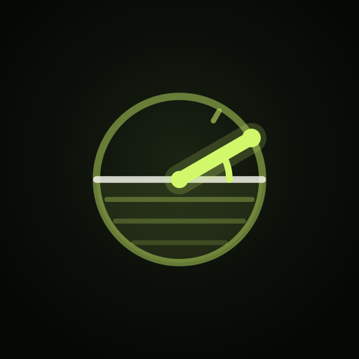
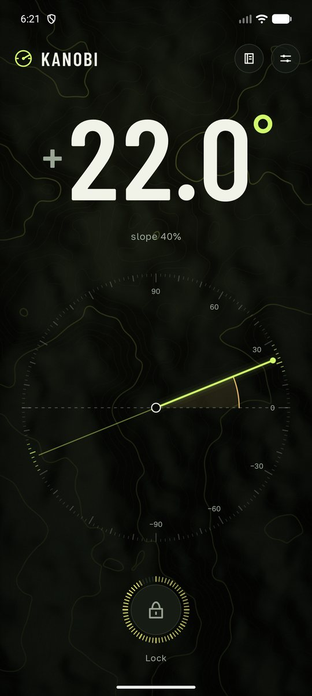
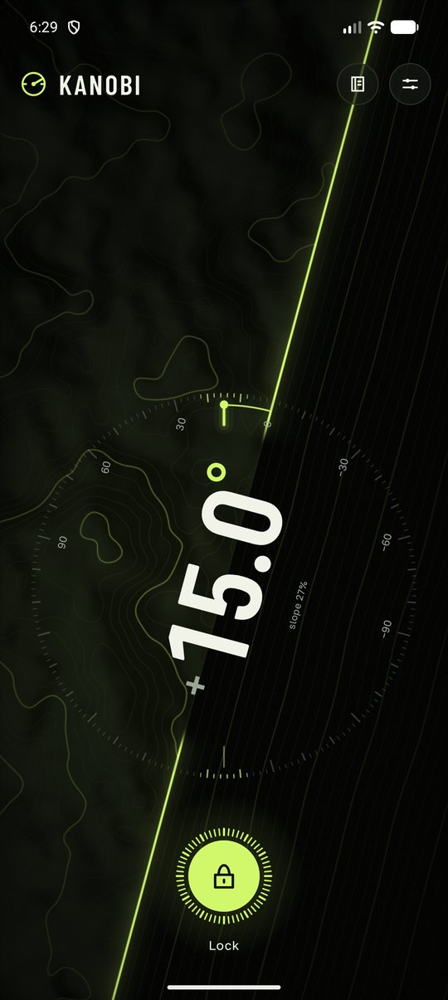
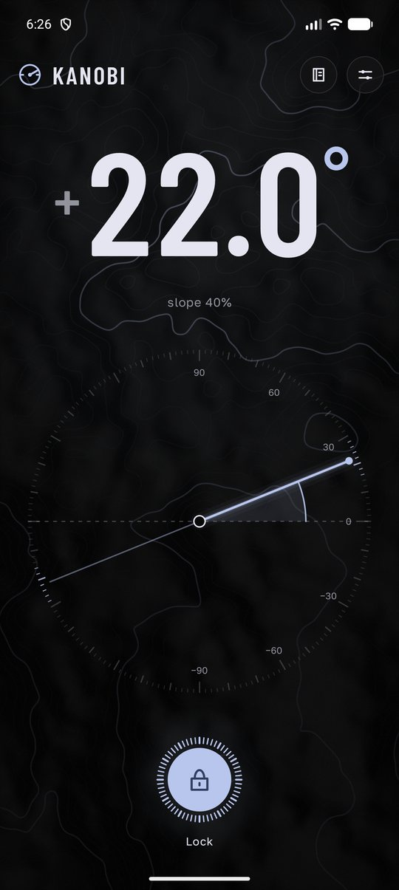
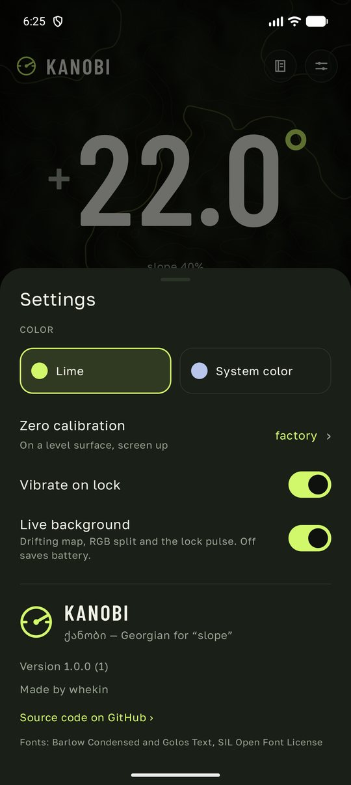

<p align="center"></p>

# Kanobi

**Kanobi** (ქანობი, Georgian for “slope”) is an Android inclinometer for the trail: takeoffs, roll-ins, drops — any surface you can lay a straightedge on. One big number, a dial, and a spirit level when the phone stands on its edge.

<p align="center">
  
  
  
  
</p>

## Features

- Angle of the phone's long side against the horizon, signed, in 0.1° steps: plus rises towards the top of the phone, minus falls. Slope in percent underneath.
- Screen up on a straightedge, or standing on its long edge. On the edge the phone turns into a spirit level: the readout and the dial follow the real horizon, the needle runs along the phone and the background shows the horizon line.
- Stability is a dwell, not a word: the reading must stay within 0.6° for 650 ms. The shutter ring fills while it does, the digits split into RGB fringes while the phone moves and snap into focus when it stops.
- Lock the angle and save it to a local journal with a name.
- Settings: lime or Material You colour, separate zero calibration for screen up and each long edge, haptics, and a “live background” switch to save battery. The first-run guide is also available from settings.
- English, Russian and Georgian, following the device language or the per-app language setting.
- No account, no network, no permissions. The screen stays on while measuring.

The angle depends on how the phone sits on the straightedge, its case, camera bump and sensor. Calibrate on a known horizontal surface in the same contact position used for measuring. Screen up, the left long edge and the right long edge each have their own offset, so camera-bump compensation never carries over onto an edge. The screen-up zero from version 1.0.0 is preserved. Check against a level surface or a known angle when in doubt. One angle says nothing about whether a jump is safe or about the curve of a takeoff.

## Under the hood

Kotlin and Jetpack Compose, Android 13+ (API 33).

- `measurement/` — gravity sensor (or an adaptive filtered accelerometer), requested at 100 Hz with no batching; the angle maths, contact-specific calibration, stability window and journal.
- `ui/` — measure screen, dial, journal, sheets, guide and settings. Instrument smoothing uses a 25 ms time constant (90% of a step in about 58 ms), while the stability gate still requires 650 ms. Dial paths and labels remain cached across sensor samples.
- `fx/` — AGSL shaders: the topographic background (value noise with analytic derivatives, so contour lines and hillshade need no `fwidth`), the horizon and the lock pulse. RGB fringes use three direct glyph draws without an offscreen RuntimeShader. The background starts at two-thirds resolution into a cached layer, follows motion at the display rate and drifts at about 30 fps when the phone is still. Sustained missed frames lower only the background texture scale to 0.5, then 0.4; instrument text, dial and RGB glyphs keep full resolution and display-rate updates.
- `theme/` — the palette, derived from the Material You accent when that is on.

## Build

JDK 17+ and Android SDK 36.

```sh
./gradlew :app:assembleDebug :app:testDebugUnitTest :app:lintDebug
./gradlew :app:assembleRelease
```

Release builds are minified with R8. They are signed with the key described in `keystore.properties` (kept out of git) when the file exists:

```properties
storeFile=release.jks
storePassword=…
keyAlias=kanobi
keyPassword=…
```

Without it they fall back to the debug key, which is fine for sideloading but not for a store. Ready-made APKs are attached to the [releases](https://github.com/whekin/kanobi/releases).

## License

MIT, see [LICENSE](LICENSE). Fonts: Barlow Condensed and Golos Text, SIL Open Font License, see `docs/licenses/`.

## Regression checks

After installing the APK on a disposable emulator:

```sh
python3 scripts/verify-emulator.py --serial emulator-5554
python3 scripts/verify-emulator.py --serial emulator-5554 --full
```

The script selects English, sets a level accelerometer pose and checks that **Journal → Settings → Zero calibration** acquires fresh stable readings and enables **Set zero**. The full mode also checks hold, keyboard entry, rapid double save, process restart and deletion of its own test record. It uses a disposable emulator and does not erase existing measurements. Unit tests cover separate contact offsets, calibration eligibility, the adaptive fallback filter and the response at 60/120 Hz. See `docs/validation.md` for actual results and remaining device checks.

## Frame pacing regression on a physical device

The `benchmark` build installs as **com.kanobi.app.benchmark**, separately from the real app.
It drives the actual UI with a repeatable 100 Hz pitch/roll sequence; values are synthetic and must not be used for measuring. The production APK contains no replay Activity.

```sh
./gradlew :app:assembleBenchmark
adb -s DEVICE install -r app/build/outputs/apk/benchmark/app-benchmark.apk
python3 scripts/profile-replay.py --serial DEVICE --effects on --output /tmp/kanobi-frames.txt
python3 scripts/measure-frame-stats.py /tmp/kanobi-frames.txt --max-jank-percent 5 --min-fps 110
# Synthetic GPU stress, not a substitute for testing a physical budget phone:
python3 scripts/profile-replay.py --serial DEVICE --gpu-load 3 --warmup 8 --output /tmp/kanobi-stress.txt
adb -s DEVICE uninstall com.kanobi.app.benchmark
```

The FPS gate assumes a 120 Hz display. Measurements on the Galaxy S25 identified the offscreen RGB text shader as a source of severe GPU stalls; version 1.0.2 replaces that filter with direct RGB glyph drawing while keeping the animated terrain, horizon and lock feedback. See `docs/validation.md` for the before/after results.
